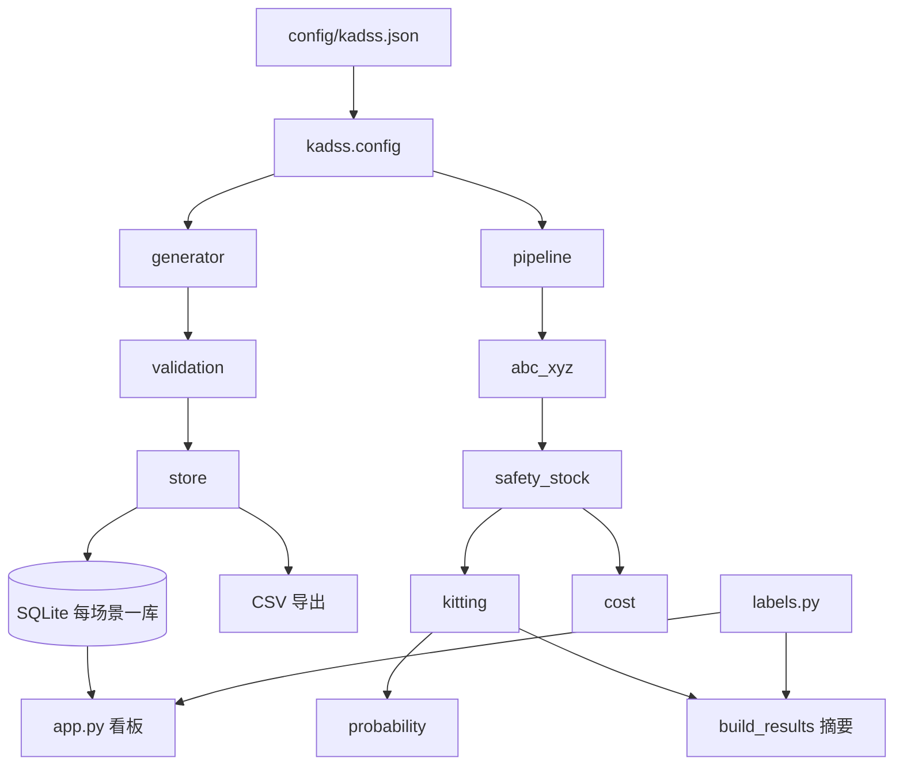
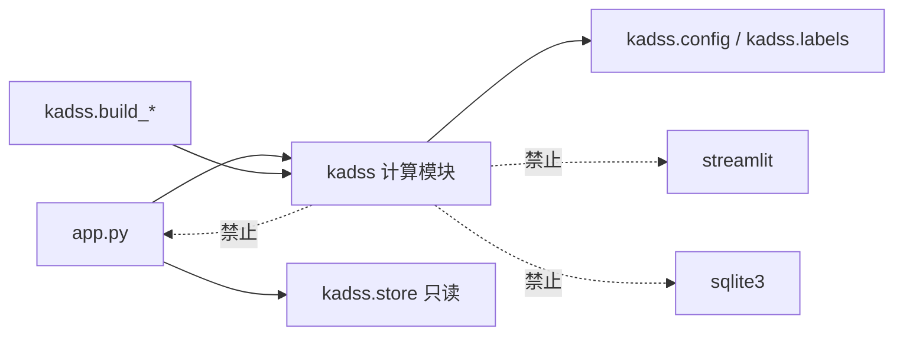
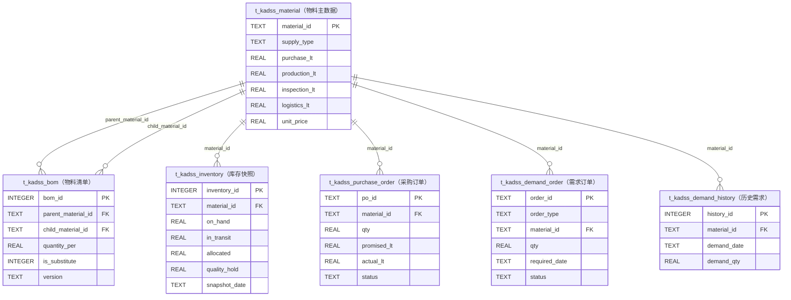
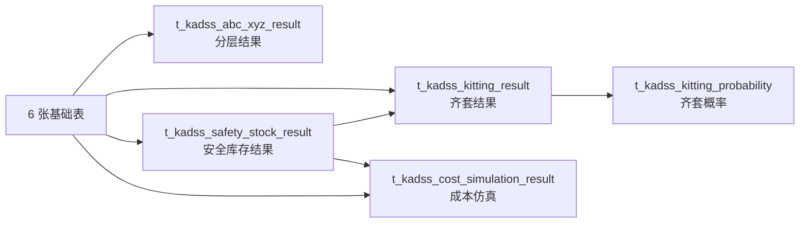

# KADSS 技术架构（轻量 TAD）

配置驱动、离线批算、结果落盘、看板只读。计算口径在 `kadss` 包内单点实现，看板只做编排、筛选与呈现。

## 设计范式

**分层批量管道（pipes-and-filters）+ 只读展示层。** 五层单向流动：

| 层 | 组成 | 职责 |
| --- | --- | --- |
| 参数层 | `config/kadss.json`、`kadss/config.py` | 场景、规模、种子、阈值、档位、成本的唯一来源 |
| 数据层 | `generator` → `validation` → `store` | 生成 6 张基础表、校验、落库并导出 CSV |
| 计算层 | `abc_xyz` → `safety_stock` → `kitting` → `probability`、`cost`，由 `pipeline` 编排 | 全部业务公式的唯一实现 |
| 持久层 | `data/<scenario>/kadss.db`、`csv/`、`summary.md` | 每场景一库；SQLite 为主源 |
| 展示层 | `app.py` | 只读 SQLite + 调用计算层函数做参数化重算 |



依赖方向即规则：



## 不变量与规则

`[ADOPTED]` 表示该约定已由 PRD 决策或现有实现确立；未标注表示本次新定、需在实现中落实。现状差距统一见“落地差距”一节。

### AD-1 — 分层边界：展示层不得持有业务公式 [ADOPTED]

- **Binds:** 全部模块；US-1 ~ US-7
- **Prevents:** 看板自建数据或复写公式，导致页面结论与批算结果、报告摘要不一致。
- **Rule:** 只允许 `app.py → kadss.*`、`kadss.build_* → kadss.*`、`kadss.pipeline → 计算模块`、`kadss.store/pipeline → sqlite3`。`abc_xyz`、`safety_stock`、`kitting`、`probability`、`cost` 不得 import `streamlit`、`app` 或 `sqlite3`；看板不得出现安全库存、缺口、概率、成本等公式。

### AD-2 — 持久化契约：SQLite 单一主源，run_id 覆盖写

- **Binds:** US-1、US-4、US-6；6 张基础表与 5 张结果表
- **Prevents:** CSV 与 DB 双写漂移；旧参数的结果混入看板；三个场景串库。
- **Rule:**
  - 基础表只经 `kadss.store.write_dataset` 写入，结果表只经 `kadss.pipeline.write_results` 写入；CSV 只由 `store.export_csv` 从 SQLite 导出，任何模块不得把 CSV 读回作为输入。
  - 每场景一库，路径固定为 `data/<scenario>/kadss.db`，场景名只来自配置。
  - `run_id = <scenario>-<参数哈希12位>-<基础数据摘要8位>`，只由 `pipeline` 计算；参数哈希固定覆盖 `seed / base_date / abc_xyz / safety_stock / kitting / probability / cost`，生成侧参数变化由基础数据摘要体现。
  - 5 张结果表每行必须携带同一个 `run_id`；每次计算先清空 5 张结果表再写入，清空与写入在同一事务内完成，提交前断言 5 张表的 `run_id` 集合都等于当前值。
  - 读库前自检：5 张结果表 `run_id` 集合相等，且与当前配置的 `seed`、`base_date` 匹配；不一致时拒绝启动并提示重建（为提交预计算库兜底）。
  - 读取基础表必须按主键排序后再计算摘要；`load_base_tables` 已按 `PRIMARY_KEYS` 排序，行序变化不再影响 `run_id`。
  - 看板只读当前库内同一 `run_id`，不得跨 run 聚合。
  - 执行顺序固定为 `build_dataset`（重建基础表）→ `build_results`（写结果表）；`build_dataset` 会重建数据库，必须先于计算执行。

### AD-3 — 计算口径单点实现

- **Binds:** US-2 ~ US-6
- **Prevents:** 同一指标在多处实现后产生偏差（可用量、缺口、Z 值、缺料率最易分叉）。
- **Rule:** 每个业务量只有一个实现位置：ABC/XYZ → `abc_xyz`；安全库存、固定基准与建议补货量 → `safety_stock`；BOM 展开与共享料分配、缺口与缺口金额 → `kitting`；齐套概率与风险分级 → `probability`；库存与缺料成本 → `cost`；可用量 → `kadss.availability`；订单齐套状态、物料/订单缺料率 → `kadss.metrics`（`gap_rates` 从 `build_results` 迁出）。看板、报告、HTML 讲解页只调用这些函数或引用其结果，不得另写一套。
- **现状要求：** 新建 `kadss/availability.py` 与 `kadss/metrics.py`，一次性收口 `safety_stock`、`cost`、`probability`、`kitting.order_status` 中重复的可用量、订单状态与缺料率实现，作为看板接入的硬前置；在此之前不得新增第三处。

### AD-4 — 配置是唯一参数面 [ADOPTED]

- **Binds:** US-1、US-3、US-6、US-7；全部阈值、档位、种子与场景差异
- **Prevents:** 看板硬编码 Z 值或场景参数，与 `config/kadss.json` 漂移。
- **Rule:** 阈值、服务水平档位、Z 值、惩罚系数、仿真次数、随机种子、场景参数只能来自 `load_config()`；`kadss/config.py:DEFAULTS` 仅作缺省兜底。新增参数先入 `DEFAULTS` 再入 `config/kadss.json`。看板控件只把值作为函数入参传入，不得内置常量表，也不得复制场景定义。

### AD-5 — 指标文案唯一来源 [ADOPTED]

- **Binds:** US-6、US-7、D-1、D-7
- **Prevents:** 看板、报告与文档对缺料率及口径说明的表述不一致。
- **Rule:** `物料缺料率（按行数）`、`订单缺料率（按订单数）`、策略口径说明与权衡说明只能引用 `kadss.labels` 常量；禁止内联字符串；禁止只写“缺料率”。空间受限时只允许短标注 `物料缺料率(行)`、`订单缺料率(单)`。

### AD-6 — 置信度单向传播 [ADOPTED]

- **Binds:** US-2、US-3、US-5
- **Prevents:** 各模块自行判定低置信，导致同一物料在不同页面结论不同。
- **Rule:** 低置信只由两处判定：ABC 的 `active_weeks < min_periods`、安全库存的日需求或交期样本不足；`pipeline._confidence_map` 合并为 `material_id → high/low` 后注入齐套明细；`probability` 与订单状态只消费该字段、不重算。任一低置信物料 → 订单概率 `null`、风险等级“数据不足”、不参与概率排序。分层、安全库存、齐套与成本明细中，低置信物料必须显示“数据置信度：低”；安全库存与成本数值保留但显式标注，不得剔除后冒充完整结论。

### AD-7 — 共享料分配与策略口径隔离

- **Binds:** US-4、US-6
- **Prevents:** 共享料被各订单重复使用；不同策略或服务水平档位之间污染可用量；default 口径与策略口径混用。
- **Rule:**
  - 订单按 `(required_date, order_id)` 升序单遍分配；每个 `(strategy, service_level)` 组合都从初始库存重新开始，跨组合不共享剩余量。
  - `gap_qty = max(req_qty - max(available_qty, 0), 0)`；单行分配后 `remaining = max(available_qty - req_qty, 0)`；展开后按物料聚合，保证每个 `(order_id, material_id)` 只产生一行。
  - `baseline` 不扣安全库存，只用于默认展示与齐套概率；`fixed` / `dynamic` 扣对应策略安全库存，只用于策略对比。
  - 齐套概率与订单齐套结论只读 `baseline @ default_service_level`。
  - BOM 只取 `is_substitute = 0` 且 `version = 'V1'` 的直接父子行；MVP 不按 `effective_date` 过滤、不展开 `is_phantom`。
  - 库存按 `material_id` 唯一读取；MVP 每个物料只允许一条当前快照，计算前断言唯一。

### AD-8 — 确定性与可复现 [ADOPTED]

- **Binds:** KPI-1、KPI-2、US-3、US-5、US-6
- **Prevents:** 同一配置重跑结果漂移；看板刷新后结论变化；`run_id` 失真。
- **Rule:**
  - 随机性只经 `seed`（主种子 + 场景偏移）派生；按实体派生时使用稳定标识（如 `zlib.crc32(material_id / order_id)`），不得用行号或时间。
  - 落盘数据不得使用运行时 `now()`：基础表 `created_at` 取业务事件日期（由生成器统一推导），结果表统一取 `base_date 00:00:00`。
  - 同配置重复运行：基础表、结果表逐行一致，`run_id` 相同。
  - 成本仿真与蒙特卡洛在相同 `seed` 下，两策略共享同一组需求与交期抽样。

### AD-9 — 看板只读边界与重算范围

- **Binds:** US-4、US-7、KPI-3、KPI-4
- **Prevents:** 看板现场重跑全流程导致卡顿；或死读落盘数据无法响应口径勾选。
- **Rule:**
  - 场景切换只切换 `data/<scenario>/kadss.db`，不触发生成或计算。
  - 参数变更只能调用 `kadss` 函数在内存中重算。重算缓存键固定为 `run_id + 可用量口径 + 服务水平 + 惩罚系数 + 模拟次数`（顺序固定），CLI 重建数据后自动失效；ABC-XYZ 分层只随场景库变化，单独以 `run_id` 作一级缓存键。
  - 勾选“安全库存”时恒扣 `default_service_level` 的 `dynamic_ss`，只在内存重算并标注口径，不得与落盘 baseline 混用。
  - 重算范围固定：可用量口径 → 齐套明细、缺口与缺料率；服务水平 → 安全库存与成本对比；惩罚系数/模拟次数 → 成本与概率；分层结果只随场景库变化。
  - 重算结果不得写回 SQLite；落盘结果只由 CLI 批处理产生。
  - 页面顶部版本信息取结果表 `run_id` 与配置中的 `seed`、`base_date`、`scale`，不新增元数据表。
  - 看板不得自建假数据或近似公式；`app.py` 现有 demo 数据路径必须移除。

## 一致性约定

| Concern | Convention |
| --- | --- |
| 命名 | 数据表统一 `t_kadss_` 前缀、snake_case；CSV 文件名与表名同名；模块名对应业务能力，不用 `utils` / `common` 收纳业务逻辑 |
| 字段语义 | `_qty` 数量、`_amount` 金额、`_rate` 0–1 比例、`_days` 天；`service_level` 为百分整数；全部提前期单位为天 |
| 枚举 | 取值以 `db/schema.sql` 的 CHECK 与配置为准；`order_type`、`risk_level` 等中文枚举直接入库，展示层不二次映射 |
| 日期时间 | 日期 TEXT `YYYY-MM-DD`；时间戳 TEXT `YYYY-MM-DD HH:MM:SS`；业务快照统一使用 `base_date` |
| ID | `run_id` 三段式；物料 `M0001`、订单 `SO20260001` 等生成规则由 `generator` 固定，计算层不得解析 ID 含义 |
| 配置 | 新增键先入 `DEFAULTS`，键名 snake_case；计算函数只接收配置字典，不读环境变量或文件 |
| 错误 | 数据校验失败抛 `DataValidationError`（CLI 退出码 1）；场景/参数错误退出码 2；不得静默跳过校验 |
| 展示 | 数据层比率为 0–1，仅展示层乘 100；每张图必须带标题、坐标轴说明与口径注释 |

## 数据模型与 ER 图

6 张基础表以物料主数据为中心；BOM 通过 parent / child 双外键关联物料，其余 4 张表均以 `material_id` 关联。5 张结果表以 `run_id` 为版本维度，不建独立实体。



结果表之间的依赖（全部结果行携带同一 `run_id`）：



| 表 | 粒度（主键） | 关键字段 | 职责 |
| --- | --- | --- | --- |
| `t_kadss_material`（物料主数据） | material_id | `supply_type`、四类提前期、`unit_price` | 物料主数据，全部策略与计算的输入 |
| `t_kadss_bom`（物料清单） | bom_id；业务唯一 parent + child + version | `quantity_per`、`is_substitute`、`version` | 只存直接父子关系，层级在展开时递归计算 |
| `t_kadss_inventory`（库存快照） | inventory_id；唯一 material + snapshot_date | `on_hand`、`in_transit`、`allocated`、`quality_hold` | 可用量分项来源 |
| `t_kadss_purchase_order`（采购订单） | po_id | `promised_lt`、`actual_lt`、`status` | 采购件交期偏差来源 |
| `t_kadss_demand_order`（需求订单） | order_id | `order_type`、`qty`、`required_date`、`status` | 五类需求订单 |
| `t_kadss_demand_history`（历史需求） | history_id；唯一 material + demand_date | `demand_qty` | 日粒度历史需求，安全库存公式输入 |
| `t_kadss_abc_xyz_result`（分层结果） | run_id + material_id | `abc_class`、`xyz_class`、`cv`、`confidence_level` | 分层结果 |
| `t_kadss_safety_stock_result`（安全库存结果） | run_id + material_id + service_level | `dynamic_ss`、`fixed_ss`、`lt_source`、`suggested_qty` | 三档安全库存与建议补货量 |
| `t_kadss_kitting_result`（齐套结果） | run_id + order_id + material_id + service_level + strategy | `req_qty`、`available_qty`、`gap_qty`、`gap_amount` | 齐套明细，三策略 × 三档服务水平 |
| `t_kadss_kitting_probability`（齐套概率） | run_id + order_id | `on_time_probability`、`risk_level`、`kitting_status` | 订单级概率与风险 |
| `t_kadss_cost_simulation_result`（成本仿真） | run_id + material_id + strategy + service_level | `avg_inventory_value`、`holding_cost`、`shortage_cost` | 固定 vs 动态策略成本 |

外键由 `PRAGMA foreign_keys = ON` 启用；`run_id` 不建物理外键，由 AD-2 的应用层事务与断言保证一致。

## Stack

| Name | Version |
| --- | --- |
| Python | 3.14.7 |
| pandas | 3.1.1 |
| numpy | 2.5.4 |
| Streamlit | 1.67.0 |
| Plotly | 7.1.0 |
| SQLite | 随 Python 3.14.7 内置 sqlite3 |

版本以当前本地实测为准。`requirements.txt` 由 `pip freeze` 锁定实际安装版本，不手填、不跨大版本升级。

## 结构种子

```text
kadss/
├── app.py                  # Streamlit 看板（只读结果 + 调用计算函数）
├── config/kadss.json       # 场景、规模、种子、阈值、成本参数
├── db/schema.sql           # 6 张基础表 + 5 张结果表 DDL
├── data/<scenario>/        # kadss.db、csv/、summary.md（每场景独立）
├── kadss/
│   ├── config.py           # DEFAULTS + 深合并加载
│   ├── generator.py        # 模拟数据生成（6 张基础表）
│   ├── validation.py       # 主键/外键/非负/BOM 无环校验
│   ├── store.py            # 建库、写基础表、导出 CSV、生成摘要
│   ├── abc_xyz.py          # ABC-XYZ 分层
│   ├── safety_stock.py     # 动态/固定安全库存与建议补货量
│   ├── kitting.py          # BOM 展开、共享料分配、缺口
│   ├── availability.py     # 可用量统一计算（新建）
│   ├── metrics.py          # 订单齐套状态、物料/订单缺料率（新建）
│   ├── probability.py      # 蒙特卡洛齐套概率与风险分级
│   ├── cost.py             # 固定 vs 动态策略成本仿真
│   ├── pipeline.py         # run_id 计算 + 计算层编排 + 结果写入
│   ├── labels.py           # 指标名称与口径文案单一来源
│   ├── build_dataset.py    # CLI：生成 → 校验 → 落库 → 导出
│   └── build_results.py    # CLI：计算 → 落库 → 打印摘要
└── docs/architecture-kadss/ # 本 TAD 与讲解页
```

## 部署与环境

| 环境 | 形态 | 关键约束 |
| --- | --- | --- |
| 本地 | `.venv` + `python -m kadss.build_dataset` → `python -m kadss.build_results` → `streamlit run app.py` | 数据由命令重建，不手工编辑 CSV |
| Streamlit Community Cloud | 从 GitHub 仓库构建，公开只读 | 目标冷启动 ≤ 30 秒，通过提交预计算库满足（TD-1）；`requirements.txt` 用 `pip freeze` 实测锁定；不得含本机路径与凭据 |

数据产物：三场景预计算库约 3.0–3.6 MB/个（合计约 9.7 MB），随仓库提交（TD-1）；读库前校验 `run_id` 与配置一致，防止提交过期快照（AD-2）。

## 性能与验收数据集

数据规模由配置 `profile` 选择，代码中不切换。`small` 为默认演示规模，输出到 `data/` 并随仓库提交；`large` 用于性能验收与面试演示，输出到 `data_large/`，不随仓库提交，按需生成。

| 规模 | 物料 | 需求订单 | 历史需求（物料×天） | BOM 平均层级 | 输出目录 |
| --- | --- | --- | --- | --- | --- |
| `small`（默认） | 200 | 50 | 90 天 / 17,520 行 | 1.93 | `data/` |
| `large`（性能验收） | 2,000 | 300 | 180 天 / 349,800 行 | 3.18 | `data_large/` |

`t_kadss_demand_order` 按订单记录，`large` 只有 300 行；`t_kadss_demand_history` 按「物料 × 天」记录日需求（含零需求日），是安全库存 `σ_d` 与 ABC-XYZ 周度 CV 的输入。两者粒度不同，历史行数不能用订单数乘天数推算。

`--scenario all` 可一次生成三个大规模场景（本机约 50 秒），只做性能验收时用 `--scenario normal` 即可。`data_large/` 不随仓库提交，避免仓库与 Cloud 构建体积膨胀。

```bash
python -m kadss.build_dataset --profile large --scenario normal
python -m kadss.build_results --profile large --scenario normal
streamlit run app.py               # 侧边栏「数据规模」切到大规模
```

性能测试集用于评估 BOM 展开、共享料分配与多策略齐套在放大 10 倍后的耗时。最近一次实测（2026-11-15，本机）：生成与落库 10.44 秒，计算 5 张结果表 11.03 秒，全流程 21.47 秒，低于 KPI-3 的 60 秒上限。`large` 不改变计算口径，只放大 `scale` 与 BOM 规模，因此不需要新的 AD。

## 能力 → 架构映射

| 能力 | 落点 | 约束 |
| --- | --- | --- |
| US-1 模拟数据 | `generator`、`validation`、`store`、`build_dataset` | AD-2、AD-4、AD-8 |
| US-2 ABC-XYZ | `abc_xyz` | AD-3、AD-6 |
| US-3 动态安全库存 | `safety_stock` | AD-3、AD-4、AD-6、AD-8 |
| US-4 BOM 齐套 | `kitting`、`kadss.availability` | AD-3、AD-7、AD-9 |
| US-5 齐套概率 | `probability` | AD-3、AD-6、AD-8 |
| US-6 成本仿真 | `cost`、`kadss.metrics`、`labels` | AD-3、AD-5、AD-7、AD-8 |
| US-7 看板 | `app.py` | AD-1、AD-2、AD-4、AD-5、AD-9 |
| KPI-1 / KPI-2 可复现、可核对 | seed 派生、单点口径、`run_id` | AD-2、AD-3、AD-8 |
| KPI-3 性能 | 场景预计算 + 内存重算 + 缓存 | AD-9 |
| KPI-5 可访问性 | 预计算产物 + `requirements.txt` | AD-2、部署约束 |

## 落地差距

| 项 | 现状 | 状态 |
| --- | --- | --- |
| 看板数据源 | [app.py](file:///Users/z2syc/project/kadss/app.py) 只读 SQLite 预计算结果，口径重算调用 `compute_kitting` / `simulate_cost` / `compute_probability`（AD-1、AD-3、AD-9） | 已关闭 |
| 场景与参数 | 场景、服务水平、Z 值、惩罚系数全部来自 `load_config()`，看板控件只传函数入参（AD-4） | 已关闭 |
| 自动化测试 | [tests/test_kadss.py](file:///Users/z2syc/project/kadss/tests/test_kadss.py) 11 个用例覆盖可用量、共享料、缺料率、安全库存、概率、`run_id` 与重算一致性 | 已关闭 |
| 大规模数据 | `profile=large` 按需生成到 `data_large/`，默认 `small` 不受影响（见「性能与验收数据集」） | 已关闭 |

## Deferred

- **自动化测试与 CI**：口径已单点收敛，补测试不改架构。
- **KPI-2 核对产物**：20 单手工/Excel 核对目前无导出脚本；补 audit 导出与最小测试夹具，不改架构。
- **5,000 物料 / 10 万行需求容量优化**：先按 KPI-3 实测，再决定是否分块或向量化，不提前引入。
- **虚拟件展开与 BOM 多版本选择**：字段已预留，MVP 固定单版本、不展开虚拟件；实现时需新增 AD。
- **需求预测、APS、多工厂多仓、权限、预警推送、自然语言问答**：PRD 明确为 v2.0 候选，不在本 TAD 范围。
- **敏感性分析的产品化呈现**：当前仅按三档服务水平输出，交互形态未定。
- **打包与发布形态**：保持仓库内可导入包，不做 PyPI 发布。

## 已确认决策

| 编号 | 议题 | 决策 |
| --- | --- | --- |
| TD-1 | 预计算库与部署 | 随仓库提交三场景 `kadss.db`（合计约 9.7 MB），移除 `.gitignore` 对 `data/**/kadss.db` 的忽略；读库前自检 `run_id` 与配置一致，防止提交过期快照。目标冷启动 ≤ 30 秒由此满足 |
| TD-2 | 公共口径模块 | 新建 `kadss/availability.py`（可用量）与 `kadss/metrics.py`（订单状态、物料/订单缺料率），同时完成缺料率的 API 化；作为看板接入硬前置 |
| TD-3 | 看板缓存粒度 | 重算键固定为 `run_id + 可用量口径 + 服务水平 + 惩罚系数 + 模拟次数`，顺序固定；ABC-XYZ 分层单独以 `run_id` 缓存。先实测，未达 3 秒阈值前不做口径矩阵预计算 |
| TD-4 | 数据规模切换 | 规模只由 `profile` 选择：`small` 输出 `data/` 并随仓库提交，`large` 输出 `data_large/` 按需生成、不入库；看板侧边栏切换规模只改数据源，不触发生成或计算 |

当前无未决阻塞项。若实现中需推翻任一决策，先修订对应 AD，再改代码。
